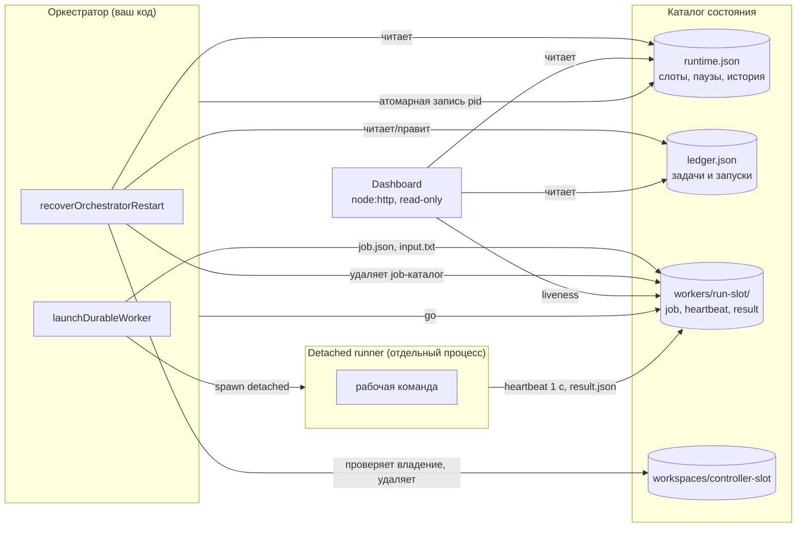

# agent-runtime

**English summary.** A small TypeScript library plus a read-only dashboard for
keeping long-running AI-agent workers observable and recoverable on a single
machine. It covers: detached workers that survive an orchestrator crash,
restart recovery that never frees a live worker or removes a workspace it
cannot prove it owns, atomic JSON state files with retry on Windows
EPERM/EBUSY, heuristic quota/rate-limit classification of process output,
and a dependency-free dashboard that shows which worker is alive, hung,
dead or finished. Extracted from a larger private monorepo; tests run on
Windows. Not covered: chaos/long-run testing, multi-host operation, any
network service beyond localhost. See "Ограничения" for details.

---

## 1. Проблема и для кого

Агент-воркер (CLI модели, скрипт, парсер) живёт часами. Типичные поломки:

- оркестратор упал или был перезапущен, а воркеры либо умерли вместе с ним,
  либо остались «осиротевшими» без записи о владельце;
- PID переиспользован ОС, и «живой» процесс на самом деле чужой;
- воркер завис: процесс есть, прогресса нет;
- провайдер вернул 429 / «usage limit», и это нельзя считать обычной ошибкой
  задачи;
- файл состояния перезаписывается во время чтения, на Windows `rename`
  падает с `EPERM`, а наблюдатель видит битый JSON.

Модуль для тех, кто запускает несколько агентов локально (ноутбук, один VPS)
и хочет, чтобы после падения система сама привела состояние в порядок и
чтобы по одному экрану было понятно, что происходит. Это не фреймворк
оркестрации: планировщика, промптов и вызовов моделей здесь нет.

## 2. Как устроено



Жизненный цикл воркера:

1. `launchDurableWorker` пишет `job.json` и `input.txt` и запускает
   *detached runner* (`runner.mjs`, только встроенные модули Node).
2. Runner **не стартует** рабочую команду, пока оркестратор не запишет файл
   `go`. Оркестратор делает это только после того, как pid runner-а
   записан в `runtime.json`. Так не бывает неотслеживаемого процесса.
3. Runner держит `heartbeat` (раз в секунду), пишет stdout/stderr в файлы
   (не в pipe) и атомарно кладёт `result.json` при завершении или по
   таймауту/`cancel`.
4. После перезапуска `recoverOrchestratorRestart` сверяет слоты из
   `runtime.json` с `ledger.json` и состоянием процессов. Живой воркер
   остаётся, мёртвый освобождается, готовый результат ждёт обработки.

### Формат файлов состояния

Всё лежит в одном каталоге (`AGENT_RUNTIME_DIR`). Схемы — zod, см.
`src/runtime-state.ts` и `src/ledger.ts`. Неизвестные/битые поля — ошибка
чтения, а не молчаливая догадка; отсутствующие необязательные поля
получают значения по умолчанию.

`runtime.json` (пишет один процесс-оркестратор, замена атомарная):

```json
{
  "schema_version": 1,
  "status": "running",              // idle | running | stopped
  "pid": 4242,                      // pid оркестратора или null
  "started_at": "2026-01-15T00:00:00.000Z",
  "updated_at": "2026-01-15T00:20:00.000Z",
  "in_flight": [ { "task_id": "T-1", "run_id": "run-1", "agent": "worker-a",
                   "attempts": 1, "last_started_at": "...", "last_outcome": null } ],
  "slots": [ {
    "slot_id": "A", "controller_id": "cycle-1", "worker": "worker-a",
    "workspace_path": "workspaces/cycle-1-A",   // относительно каталога состояния
    "task_id": "T-1", "run_id": "run-1",
    "pid": 5150,                    // pid detached runner-а
    "job_dir": "workers/run-1-A",
    "started_at": "...", "heartbeat_at": "...",
    "status": "running"             // starting | running | completed | failed | crashed
  } ],
  "cooldowns": [ { "agent": "worker-b", "until": "2026-01-15T00:45:00.000Z",
                   "reason": "quota limit: ..." } ],
  "history": [ { "at": "...", "message": "..." } ]   // хранятся последние 200
}
```

`ledger.json`: `tasks[]` (`id`, `title`, `status` из
`todo|ready|in_progress|validating|blocked|done`, `depends_on`,
`active_run_id`, `attempts`, `last_error`, ...), `runs[]` (`id`, `task_id`,
`agent`, `status`, `phase` из `ready|leased|running|blocked-on-dep|waiting-quota|done|failed`,
`result`, `result_id`) и `agents[]` (`name`, `available`,
`unavailable_reason`). Минимальный синтетический пример строится в
`demo/fixture.ts`.

Дополнительно: `runtime.lock` (pid-замок на всё время жизни оркестратора),
`ledger.lock` (короткий замок на read-modify-write), `runtime.log`.

## 3. Ключевые решения и почему

- **Detached runner + gate `go`.** Воркер переживает оркестратор, а pid
  гарантированно записан до старта работы. Проверено тестом, который
  убивает процесс-оркестратор `SIGKILL`-ом и убеждается, что воркеры живы,
  не пере-запущены (счётчик запусков не растёт) и их результат читается.
- **PID + heartbeat, а не только PID.** Живой pid без свежего heartbeat
  считается не-живым: это защищает от переиспользования pid и позволяет
  отличить `hung` от `alive`. Та же функция используется и
  восстановлением, и дашбордом (`classifySlotLiveness`), поэтому оператор
  видит то, что решит recovery.
- **Recovery по принципу «не знаю — не трогаю».** Перед удалением
  workspace проверяются: уникальность владения (слот, workspace, задача,
  run), совпадение слота с задачей/run в `ledger.json`, имя каталога
  `<controller_id>-<slot_id>` внутри `workspaces/`, и (по умолчанию)
  путь строго внутри управляемого каталога. Любое несовпадение оставляет
  слот в статусе `crashed`, задачу `blocked` и ничего не удаляет.
- **Порядок «пометить → почистить → освободить».** Слот сначала
  сохраняется как `crashed`, затем чистится workspace, затем обновляется
  ledger и только потом слот освобождается. Падение между шагами
  восстанавливается повторным запуском (тесты на каждый шаг).
- **Завершённый воркер — не падение.** Если `result.json` уже есть, слот
  не отбирается, даже когда runner и оркестратор давно мертвы; слот
  `completed` с пустым pid получает один интервал heartbeat на обработку.
- **Атомарная запись с ретраями.** Временный файл в той же папке,
  `fsync`, `rename`; для `EPERM/EBUSY/EACCES` — ограниченный backoff с
  джиттером. Старый файл никогда не удаляется и не усекается, при полном
  провале остаётся временный файл как улика, ошибка типизирована
  (`AtomicWriteError`).
- **Квота — эвристика, не парсер.** `classifyProcessOutcome` отличает
  отказ провайдера от отчёта, в котором просто упомянут «429». Время
  сброса намеренно не извлекается.
- **Дашборд без зависимостей.** `node:http` + обработчик, не зависящий от
  транспорта (тесты вызывают его напрямую). Только `127.0.0.1`, защита от
  DNS-rebinding (проверка `Host`) и CSRF (проверка `Origin` у не-GET).

### Починка падающего на Windows теста жизненного цикла

В исходном репозитории `lifecycle.test.ts` падал с `EPERM` при `rename` и
`unhandled rejection`. Причина, воспроизведённая здесь:

1. `rename` поверх файла, который в этот момент читает другая задача,
   на Windows даёт `EPERM`. Хелпер теста делал голый `writeFile` +
   `rename` в режиме `void` (без ожидания), а `startRuntime` в это время
   опрашивает тот же файл.
2. Первая же ошибка становилась необработанным отказом промиса, pid не
   записывался, опрос заканчивался таймаутом.
3. Фоновую запись никто не дожидался перед удалением временного каталога.

Исправление (тест не вырезан): запись идёт через боевой атомарный писатель
с ретраями; все фоновые записи отслеживаются и ожидаются в `afterEach`
до очистки, а провалы проверяются (`expect(errors).toEqual([])`); каталог
удаляется с ретраями; читатели (`readRuntimeState`, `readLedger`,
результат воркера) используют `readTextRetry`; runner воркера ретраит
`rename` результата. Воспроизведение: `node scripts/repro-windows-rename.mjs`.

## 4. Результаты и цифры

Только то, что измерено в этом репозитории на Windows 11, Node 24.19.0:

| Что | Значение | Откуда |
|---|---|---|
| Тесты | 113 прошли, 11 файлов, ~16 с | `npm test` |
| Typecheck | чистый (`strict`, `noUncheckedIndexedAccess`, `exactOptionalPropertyTypes`) | `npm run typecheck` |
| Сборка | `dist/` собирается без ошибок | `npm run build` |
| `lifecycle`-набор | 5 прогонов подряд: 22/22 без падений | цикл `vitest run` |
| Голый `rename` поверх читаемого файла | 479 из 500 попыток `EPERM`; без читателя 0 из 500 | `scripts/repro-windows-rename.mjs 500` (одно измерение, значение зависит от машины и антивируса) |
| Исходный объём | `runtime-health.ts` 846 строк в источнике; в модуле `src/` — 3054 строки включая дашборд | `wc -l` |

Разбивка тестов: `runtime-health` 33, `dashboard-app` 15,
`runtime-state` 12, `atomic-file` 10, `dashboard-state-reader` 10,
`durable-worker` 7, `ledger` 7, `dashboard-lifecycle` 7, `quota` 6,
`fs-retry` 5, `demo` 1.

Числа о влиянии на реальную продуктивность (аптайм, число спасённых
запусков и т. п.) не приводятся: таких измерений нет.

## 5. Ограничения и что дальше

- **Chaos- и long-run-тестов нет.** В исходном проекте это была
  запланированная, но не реализованная фаза; здесь она тоже не сделана.
  Тесты проверяют конкретные сценарии (убийство оркестратора, смерть
  одного воркера, падение между шагами recovery), но не случайные сбои
  часами.
- **Одна машина, один оркестратор.** Замки — файловые, pid-проверки —
  локальные. Нет работы по сети и между хостами.
- **Нет оркестратора.** Планирование, выбор задач, обработка результата,
  запуск моделей, git-worktree — вне модуля. В оригинале workspace был
  git worktree с проверкой ветки; здесь это обычный каталог в
  `workspaces/` с проверкой имени. Также убраны миграции записей старых
  версий (слот без `run_id`/`controller_id` теперь невалиден).
- **Windows-специфика проверена только на Windows 11.** Ветки для POSIX
  (`SIGTERM`/`ps`) перенесены из исходника и в этом репозитории на Linux
  или macOS не запускались.
- **Классификация квоты — регулярные выражения** по англоязычным
  сообщениям; другие провайдеры и языки могут не распознаться.
- **Дашборд без аутентификации** (только loopback) и опрос раз в 3 с,
  без push. Кнопка «Старт» работает, только если задан
  `AGENT_RUNTIME_START_COMMAND`; «Стоп» шлёт `SIGTERM` pid из
  `runtime.json`.
- **Отображение живости воркеров в дашборде** — новая надстройка над
  существующими предикатами recovery (в исходном дашборде слотов не было).
- Heartbeat 20 с и стартовый grace 60 с — константы, не настройки.
- Опрос файла с очень малым интервалом (единицы мс) на Windows может
  держать `rename` дольше бюджета ретраев (по умолчанию ~1,5 с);
  при медленных читателях (50–400 мс) в разовом ручном замере отказов не
  было, но это не закреплено тестом-замером.

Что дальше (не реализовано): chaos-сценарии (случайные kill/квота/рестарт
с инвариантами «ни один слот не утерян, ни один workspace чужой не
удалён»), метрики потребления токенов, push-обновление дашборда.

## 6. Как запустить

Нужен Node.js 20+ (проверено на 24.19.0).

```bash
npm install
npm test            # 113 тестов
npm run typecheck
npm run build       # dist/
npm run demo        # дашборд на синтетическом состоянии, http://127.0.0.1:4877
```

`npm run demo` создаёт временный каталог с синтетическим состоянием:
слот A жив, B «завис» (pid жив, heartbeat десятиминутный), C мёртв,
D завершился с результатом; провайдер `worker-b` стоит на паузе по
квоте (причина получена реальным `classifyProcessOutcome`). Внешних
сервисов не нужно, при остановке (Ctrl+C) каталог удаляется. Порт можно
задать `AGENT_RUNTIME_PORT`.

Направить дашборд на реальное состояние: каталог должен содержать
`runtime.json` (и по желанию `ledger.json`) в формате выше.

```bash
AGENT_RUNTIME_DIR=/path/to/state-dir AGENT_RUNTIME_PORT=4877 npm run dashboard
# или после npm run build:
AGENT_RUNTIME_DIR=/path/to/state-dir npm start
```

Переменные окружения — в `.env.example` (секретов нет).

Использование как библиотеки (после `npm run build`, экспорт — `dist/index.js`):

```ts
import {
  launchDurableWorker, releaseDurableWorker, awaitDurableWorker,
  writeRuntimeState, readRuntimeState, recoverOrchestratorRestart,
  classifyProcessOutcome,
} from "./dist/index.js"; // путь к собранному пакету
```

Порядок для воркера: `launchDurableWorker` → сохранить pid в слоте через
`writeRuntimeState` → `releaseDurableWorker` → `awaitDurableWorker`
(он же подходит после рестарта: нужны только `job_dir` и `pid` из слота).
На старте оркестратора вызывайте `recoverOrchestratorRestart` (или
`recoverOrchestratorRestartWithGrace`).

## 7. Моя роль

Продуктовая постановка, архитектура и приёмка — мои. Код написан ИИ-агентами (Claude, Codex) под моим управлением.

Я, владелец проекта: поставил продуктовую задачу (что должно пережить
падение, чего нельзя делать при восстановлении), определил архитектуру
и границы модуля (что остаётся в библиотеке, что вынесено в
оркестратор), принимал результат: сценарии приёмки, прогон тестов на
Windows, разбор причины падающего теста, решение, что не обещать в
README. Код написан с помощью ИИ-агентов (Claude, Codex) под моим
управлением и проверкой.

## Связанные репозитории

- [developer-factory-case](https://github.com/potia-byte/developer-factory-case) — архитектура системы ИИ-агентов, частью которой был этот модуль
